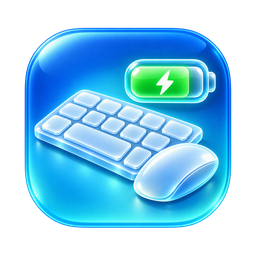
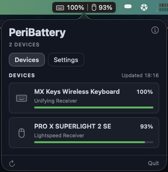

<p align="center">
  
</p>

# PeriBattery

A macOS menu bar app that shows the battery level of Logitech keyboards and
mice connected through a Unifying, Bolt or Lightspeed receiver.

<p align="center">
  
</p>

PeriBattery lives only in the menu bar (no Dock icon, no main window). It talks to
the devices directly over HID++ through their USB receivers, so it needs
neither Logitech Options+ nor any Logitech software running.

The app ships as `PeriBattery.app` because Homebrew's official `battery` cask
already installs an unrelated `Battery.app`. The repository, Xcode project,
scheme and bundle identifier (`com.juancasanueva.battery`) keep the original
`battery` name, so the source still lives in `SWIFTUI_battery`.

## Features

- **Menu bar icons**: a keyboard and a mouse symbol, each with its percentage
  and a charging indicator while the device charges, separated by a hairline on
  a rounded card.
- **Panel**: click the icon for a popover with a card per device (name, level,
  charging state, gauge and how it is connected), when the readings were last
  updated, a refresh button (`⌘R`) on the left and Quit (`⌘Q`) on the right.
  `Esc` closes it; the ⓘ button opens the About window.
- **Right-click menu** on the icon: About PeriBattery, Check for Updates… and
  Quit.
- **Receivers**: Logitech Unifying, Bolt and Lightspeed receivers, several at once. Devices
  are rediscovered when a receiver is plugged in or a device connects, and
  re-read every five minutes and on every panel open.
- **USB cable**: a device plugged in to charge is read over the cable and shown
  once, merged with its receiver entry.
- **Settings tab** in the panel: launch at login and updates.

## Install

Releases need macOS 15.6 or later on Apple silicon.

With [Homebrew](https://brew.sh):

```sh
brew trust juancasanueva/tap   # Homebrew 6.0.22 or later only
brew tap juancasanueva/tap
brew install --cask juancasanueva/tap/peribattery
```

Homebrew 6.0.22 and later refuse to tap a third-party tap that carries a cask
until it is trusted, which is what the first line does; skip it on older
Homebrew.

**Already have `PeriBattery.app` in `/Applications`?** Homebrew refuses to
overwrite an app it did not place. Let it adopt the existing copy instead:

```sh
brew install --cask --adopt juancasanueva/tap/peribattery
```

Or download the latest `PeriBattery-<version>.zip` from [Releases](../../releases),
unzip it, and drag `PeriBattery.app` to `/Applications`. The build is notarized and
stapled, so the first launch is an ordinary "Open" confirmation.

To update, `brew upgrade --cask juancasanueva/tap/peribattery` (or let the app
update itself, below). To remove it,
`brew uninstall --cask --zap juancasanueva/tap/peribattery` also deletes PeriBattery's
preferences and caches.

### Input Monitoring

macOS treats reading a keyboard receiver as input monitoring. If the panel
shows **Permission needed**, click **Open Settings…** and allow PeriBattery under
System Settings › Privacy & Security › Input Monitoring, then reopen the panel.

## Updates

PeriBattery updates itself with [Sparkle](https://sparkle-project.org) from an
EdDSA-signed appcast published with each release. Open the panel's
**Settings** tab and click **Check for Updates…**, or turn on **Automatically
check for updates** (once a day). Automatic checking is off until you turn it
on. Prereleases are never offered.

Releases are cut by pushing a `v*` tag; see [RELEASING.md](RELEASING.md) for the
pipeline, the one-time setup and troubleshooting.

## Launch at login

Turn on **Launch at login** in the panel's **Settings** tab. It registers the
app with macOS as a login item (`SMAppService`). If macOS asks for approval,
the card says so and **Open Login Items** takes you to System Settings ›
General › Login Items, where PeriBattery must be allowed.

## Tested hardware

- Logitech MX Keys, through a Unifying receiver.
- Logitech PRO X SUPERLIGHT 2 SE, through its Lightspeed receiver and by USB cable.

Other HID++ 2.0 devices that report battery through UnifiedBattery (`0x1004`),
BatteryStatus (`0x1000`) or BatteryVoltage (`0x1001`) should work, but have not
been tried.

## Build and run

Requirements: macOS 15.6 or later, Xcode 26.

```sh
# Build
xcodebuild -project battery.xcodeproj -scheme battery -destination 'platform=macOS' build

# Unit tests
xcodebuild -project battery.xcodeproj -scheme battery -destination 'platform=macOS' \
  test -only-testing:batteryTests
```

Or open `battery.xcodeproj` in Xcode and run the `battery` scheme; it builds
`PeriBattery.app` (the Swift module stays `battery`). The only package dependency is Sparkle 2.9.6 (Swift Package
Manager).

The app is **not sandboxed**, so Sparkle can replace it in place, and it uses
the hardened runtime.

## Layout

```
battery/
  App/        AppDelegate: composition root, status item and updater wiring
  HIDPP/      HID++ reports, features, battery features and the IOKit transport
  Devices/    Device discovery and probing, slot cache, DeviceService
  MenuBar/    Status item, its image and label formatting
  Panel/      The popover: tabs, device cards and battery gauge
  Settings/   Settings tab, launch at login (SMAppService)
  Updates/    Sparkle adapter, update policy, automatic checks
  Shared/     Chips, section headers and theme
scripts/      Release build and appcast scripts
```

Swift Testing suites live in `batteryTests/`, covering HID++ parsing, device
probing, receiver bookkeeping, menu bar formatting, the panel, launch at login,
updates and the release pipeline's files.

## License

PeriBattery is released under the [MIT License](LICENSE.md).
